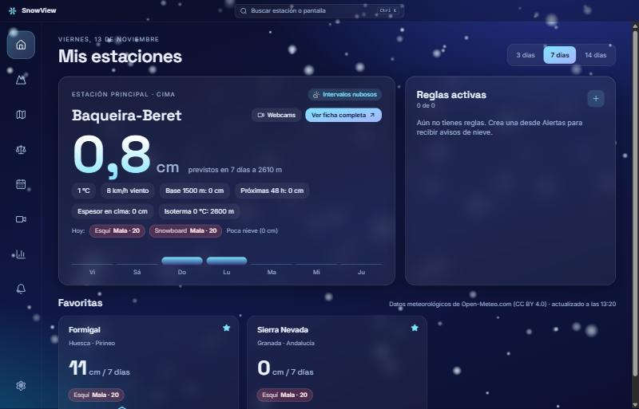
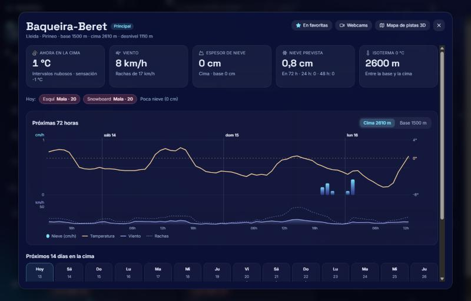
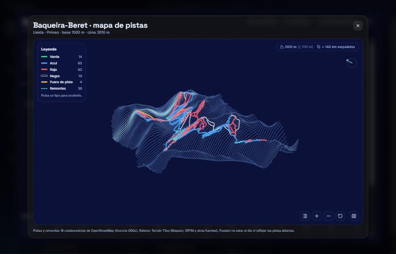
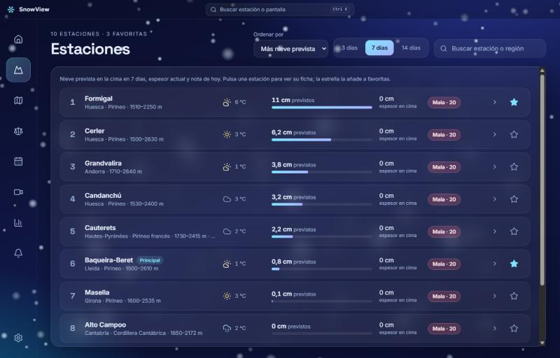

# SnowView

Monitor de nieve para estaciones de esquí. Muestra la nieve prevista y acumulada de tus estaciones
favoritas y avisa cuando se cumple una regla, por ejemplo "más de 15 cm en las próximas 48 h".

App de escritorio para Windows 11 hecha con Tauri 2, React y TypeScript.



## Qué hace

- **Previsión de nieve** de 10 estaciones de España, Andorra y el Pirineo francés, a la cota de la
  base y de la cima, para 3, 7 o 14 días.
- **Ficha de cada estación**: temperatura y sensación térmica, viento y rachas, espesor de nieve,
  isoterma de 0 °C, gráfica hora a hora de 72 h y los próximos 14 días.
- **Clasificación de estaciones** por nieve prevista, espesor o nota del día.
- **Nota de 0 a 100** para esquiar o hacer snowboard cada día, con sus motivos, y un calendario con
  los mejores días.
- **Avisos de Windows** cuando se cumple una regla tuya («más de 15 cm en 48 h»), también con la
  ventana cerrada (la app sigue en la bandeja).
- **Mapa de pistas** de cada estación sobre la montaña en 3D, que gira 360°, y plano 2D con relieve
  y curvas de nivel.
- **Mapa de España** con las estaciones, tu ubicación y la distancia a cada una.
- **Webcams** de las estaciones, comparador, historial de nevadas por temporada y modo sin conexión.
- **Buscador rápido** con Ctrl+K y atajos Ctrl+1…9. Sin cuentas ni claves: todo funciona al
  instalar.

| Ficha de estación                            | Mapa de pistas 3D                                    |
| -------------------------------------------- | ---------------------------------------------------- |
|  |  |



## Instalar

Genera los instaladores con `pnpm build`: quedan en `src-tauri/target/release/bundle/` (`.msi` y
`-setup.exe`). No llevan firma de código, así que Windows puede mostrar un aviso de SmartScreen la
primera vez.

## Estado

Versión **1.0.0**: la app está terminada. El detalle de cada fase está en `docs/fase-*/README.md`,
el avance en [docs/PROGRESO.md](docs/PROGRESO.md) y las decisiones técnicas en `docs/adr/`.

## Versiones

Cambios por versión en [CHANGELOG.md](CHANGELOG.md). Ramas, etiquetas y cómo se publica en
[docs/VERSIONES.md](docs/VERSIONES.md).

## Estructura

```
packages/core   Lógica pura: modelos, acumulados y reglas (sin UI ni plataforma)
packages/data   Clientes de API, caché y normalización
apps/web        Interfaz: React, Vite, Tailwind y Motion
src-tauri       App de escritorio (Tauri 2, Rust)
docs/           Decisiones técnicas (ADR) y un README por fase
```

## Uso rápido

```bash
pnpm install
```

```bash
pnpm dev
```

```bash
pnpm check
```

`pnpm dev` abre la app de escritorio; `pnpm build` genera los instaladores. Ramas y versiones en
[docs/VERSIONES.md](docs/VERSIONES.md).

## Datos meteorológicos y licencia

SnowView usa la API de [Open-Meteo](https://open-meteo.com), que no necesita clave. Su uso gratuito
es **solo para fines no comerciales**, y los datos se publican bajo licencia CC BY 4.0, que obliga a
citar la fuente. Si SnowView llega a distribuirse con fines comerciales, habrá que contratar un plan
de Open-Meteo o cambiar de proveedor. La capa `packages/data` está pensada para poder hacerlo sin
tocar la interfaz.
